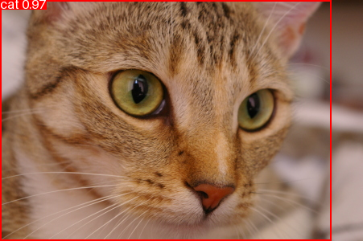
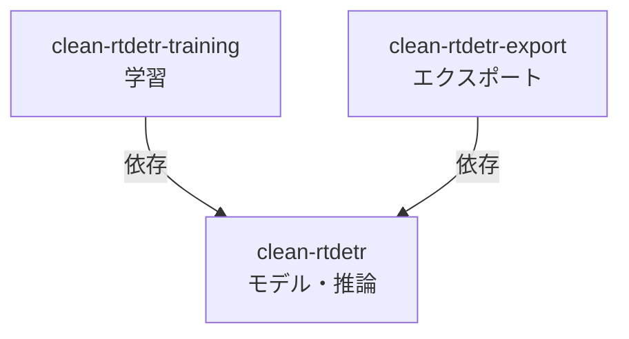

# Clean RT-DETR

[English](README.md) | 日本語

読みやすさを重視し、研究用の拡張を組み合わせられる RT-DETR の参照実装。
モデルの派生形、学習手法、実験レシピを、デプロイ用の変換から分離する設計を採用している。

実装済みの機能、検証結果、今後の予定は[実装ロードマップ](docs/ja/roadmap.md)を参照。

## クイックスタート

COCO で学習済みの R50vd モデルを使い、同梱のサンプル画像から物体のクラス・スコア・位置を取得する。
Python 3.13 または 3.14 と uv を用意し、リポジトリのルートで以下を実行する。

1. 画像推論に必要な依存関係をインストール。

    ```sh
    $ uv sync --package clean-rtdetr --extra inference
    ```

2. 公式の学習済み重みをダウンロードし、本レポジトリで読み込める形式に変換。

    ```sh
    $ curl --fail --location --create-dirs \
        --output checkpoints/official.pth \
        https://github.com/lyuwenyu/storage/releases/download/v0.1/rtdetr_r50vd_6x_coco_from_paddle.pth

    $ uv run clean-rtdetr-convert \
        --checkpoint checkpoints/official.pth \
        --output checkpoints/native.pth
    ```

3. CPU 上で推論を実行し、スコア 0.5 以上の候補を表示する。

    ```sh
    $ uv run clean-rtdetr-predict assets/samples/cat.png \
        --checkpoint checkpoints/native.pth \
        --device cpu \
        --conf-thresh 0.5 \
        --visualize-dir outputs

    [
        {
            "image": "assets/samples/cat.png",
            "original_size_wh": [451, 300],
            "labels": [15],
            "scores": [0.9715],
            "boxes_xyxy": [[0.0651, -0.0394, 411.9597, 299.9576]]
        }
    ]
    ```

    | 入力画像 | 出力画像（検出結果） |
    | --- | --- |
    |  |  |

Python API と入出力の詳細は[推論ガイド](docs/ja/inference.md)を参照。

## パッケージ構成

RT-DETR をはじめとする物体検出ライブラリでは、学習の都合がモデル本体に入り込み、
エクスポート時に不要なモジュールが残ったり、個別のパッチが必要になったりすることがある。

Clean RT-DETR は、こうした責務の混在による設計の腐敗を防ぐため、
モデル本体、学習、エクスポートをそれぞれ別のパッケージに分離する。
学習やエクスポートに固有の依存関係をモデル本体に持ち込まない構成とする。

uv ワークスペースから、依存関係が一方向の 3 パッケージを公開する。



各メンバーには独自のメタデータ、README、ソース、テストがあり、個別にビルド・公開できる。
ルートの `pyproject.toml` はワークスペースと共通開発ツールを管理する。
リポジトリのルート自体は Python 配布パッケージではない。

## 開発への参加

開発環境、検証コマンド、静的検査の方針、実装上の注意点は
[CONTRIBUTING.ja.md](CONTRIBUTING.ja.md)を参照。

## 研究の方向性

[設計提案](docs/ja/design-proposal.md)では、目標とする
`ModelVariant × TrainingMethod × ExperimentRecipe` アーキテクチャを説明している。
コンポーネントの境界は[拡張ガイド](docs/ja/extensions.md)、研究成果の受け入れ基準は
[実装ロードマップ](docs/ja/roadmap.md#research-acceptance)を参照する。

## ライセンス

Clean RT-DETR は [Apache License, Version 2.0](LICENSE) で提供される。
同梱した RT-DETR ソースとその改変には、上流の Apache-2.0 ライセンスと帰属表示を保持している。
詳細は [third_party/RT-DETR/README.md](third_party/RT-DETR/README.md) を参照する。

## 出典

[lyuwenyu/RT-DETR](https://github.com/lyuwenyu/RT-DETR) のコミット
`068dfde65f2667ad6555883c69d73de886518cad` に基づいている。
上流由来のモジュールには変更の告知を付けている。一致検証に使用する
[参照実装のソースとライセンス](third_party/RT-DETR/README.md)も保持している。
[ベースラインのメタデータ](benchmarks/baseline.json)には、公式チェックポイントの URL、SHA-256、EMA の取得元を記録している。
検証レポートとその対象範囲は[実装ロードマップ](docs/ja/roadmap.md)にまとめている。
