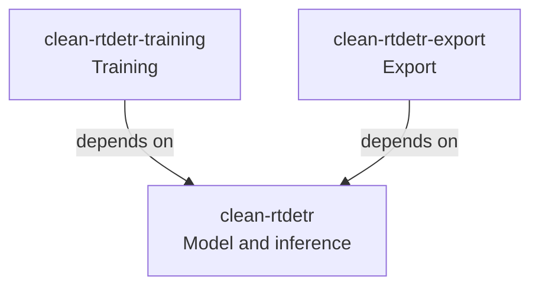

# Clean RT-DETR

English | [日本語](README.ja.md)

A readable RT-DETR reference implementation designed for composable research
extensions.
It separates model variants, training methods, and experiment recipes from
deployment transformations.

See the [implementation roadmap](docs/roadmap.md) for implemented features,
validation results, and planned work.

## Quick start

Use a COCO-trained R50vd model to obtain object classes, scores, and positions
from the bundled sample image.
Use Python 3.13 or 3.14 and uv, then run the following from the repository root.

1. Install the dependencies required for image inference.

    ```sh
    $ uv sync --package clean-rtdetr --extra inference
    ```

2. Download the official pretrained weights and convert them to a format that
   this implementation can load.

    ```sh
    $ curl --fail --location --create-dirs \
        --output checkpoints/official.pth \
        https://github.com/lyuwenyu/storage/releases/download/v0.1/rtdetr_r50vd_6x_coco_from_paddle.pth

    $ uv run clean-rtdetr-convert \
        --checkpoint checkpoints/official.pth \
        --output checkpoints/native.pth
    ```

3. Run inference on the CPU and display candidates with scores of at least 0.5.

    ```sh
    $ uv run clean-rtdetr-predict assets/samples/cat.png \
        --checkpoint checkpoints/native.pth \
        --device cpu \
        --conf-thresh 0.5 \
        --visualize-dir outputs

    [
        {
            "image": "assets/samples/cat.png",
            "original_size_wh": [451, 300],
            "labels": [15],
            "scores": [0.9715],
            "boxes_xyxy": [[0.0651, -0.0394, 411.9597, 299.9576]]
        }
    ]
    ```

    | Input image | Output image (detections) |
    | --- | --- |
    |  |  |

See the [inference guide](docs/inference.md) for details on the Python API and
inputs and outputs.

## Package structure

In object detection libraries including RT-DETR, training concerns can leak
into the model itself, leaving unnecessary modules during export or requiring
ad hoc patches.

Clean RT-DETR separates the model, training, and export into distinct packages
to prevent this mixing of responsibilities from degrading the model's design.
Dependencies specific to training and export are kept out of the model package.

The uv workspace publishes three packages with one-way dependencies.



Each member has its own metadata, README, source, and tests, and can be built
and published independently.
The root `pyproject.toml` manages the workspace and shared development tools.
The repository root itself is not a Python distribution package.

## Contributing

See [CONTRIBUTING.md](CONTRIBUTING.md) for the development environment,
validation commands, static-checking policy, and implementation notes.

## Research direction

The [design proposal](docs/design-proposal.md) describes the intended
`ModelVariant × TrainingMethod × ExperimentRecipe` architecture.
See the [extension guide](docs/extensions.md) for component boundaries and the
[implementation roadmap](docs/roadmap.md#research-acceptance) for the acceptance
criteria for research results.

## License

Clean RT-DETR is licensed under the [Apache License, Version 2.0](LICENSE).
The bundled RT-DETR source and its adaptations retain the upstream Apache-2.0
license and attribution notices.
See [third_party/RT-DETR/README.md](third_party/RT-DETR/README.md) for details.

## Provenance

Based on commit `068dfde65f2667ad6555883c69d73de886518cad` of
[lyuwenyu/RT-DETR](https://github.com/lyuwenyu/RT-DETR).
Upstream-derived modules carry change notices.
The [source and license of the reference implementation](third_party/RT-DETR/README.md)
used for parity verification are retained.
[Baseline metadata](benchmarks/baseline.json) records the official checkpoint
URL, SHA-256, and EMA source.
Validation reports and their scope are summarized in the [implementation
roadmap](docs/roadmap.md).
