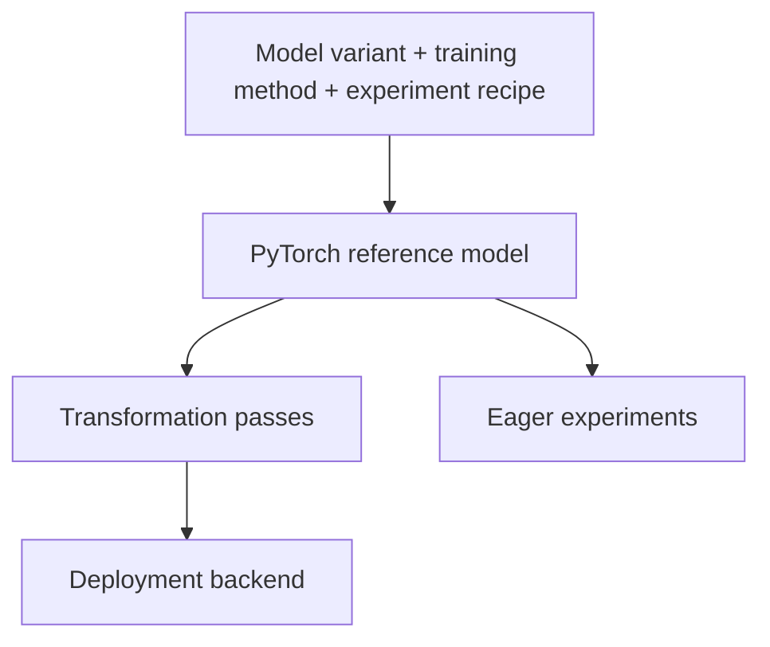

# Architecture proposal

English | [日本語](ja/design-proposal.md)

This proposal explains how Clean RT-DETR should preserve RT-DETR semantics while
supporting research extensions and deployment optimizations. It is for PyTorch
engineers deciding where a new component belongs and how to validate it.

**Status:** architecture target, based on proposal v0.3 (2026-09-05). The
interfaces, deployment profiles, and acceptance targets below are proposals.
For implemented APIs and measured results, use the [extension guide](extensions.md)
and [roadmap](roadmap.md).

## Compatibility baseline

The initial reference is `rtdetr_pytorch` RT-DETR-R50vd: COCO 80 classes,
640×640 RGB input, 300 queries, and six decoder layers. The upstream revision is
`068dfde65f2667ad6555883c69d73de886518cad`; configuration and checkpoint provenance
are pinned in [baseline metadata](../benchmarks/baseline.json) and
[upstream records](../third_party/RT-DETR/README.md).

Preserve the reference computation before adding optimizations. Changes to an
architecture, objective, or numerical behavior need their own configuration and
comparison results. The project does not aim to build a general detection
framework or support every combination of backbone, method, and backend.

## Separate computation, transformation, and execution

The arrows show construction and execution flow. Code dependencies point from
backends to transformations/export to models and shared contracts. The reference
model must not depend on a backend SDK or training framework. Start with PyTorch
modules and tensor export schemas; a custom intermediate representation is not
required.

| Reference component | Responsibility |
| --- | --- |
| Backbone and HybridEncoder | Produce multi-scale features, including explicit access to the AIFI boundary when requested |
| MemoryProjector | Project and flatten features for decoder memory; derive level shapes and offsets from actual features |
| QuerySelector | Build anchors, score memory, select top-k queries, and retain differentiable encoder auxiliary predictions |
| Query assembly | Combine prepared DN and matching queries, masks, and initial references |
| Decoder and prediction heads | Run attention and iterative refinement; own layer heads and their gradient paths |
| Training wrapper | Register DN embeddings and auxiliary modules, build queries, separate predictions, and pass assignments to losses |
| Postprocessor | Convert raw predictions to scores, class indices, and original-image coordinates |

These are responsibility boundaries, not a requirement for one public class per
row. A box head updates the next decoder layer's reference, so it cannot be moved
to a single post-decoder stage without changing the computation.

## Preserve tensor and gradient contracts

Contracts must define shape, dtype, layout, coordinates, masks, and gradient
ownership. Current types belong to the [extension reference](extensions.md);
future variants may define their own refinement state and training payload.
Share the final raw detection boundary: logits `[B, Q, K]` and normalized cxcywh
boxes `[B, Q, 4]`, where `B` is batch size, `Q` query count, and `K` class count.

The following baseline details require explicit parity checks:

- Flatten each level with `feature.flatten(2).transpose(1, 2)` and concatenate
  levels in order. Derive spatial shapes from the actual features.
- Keep `(cx, cy, w, h)` boxes and `(W, H)` original image sizes distinct.
  The baseline resizes the entire image to 640×640 without padding or mean/std
  normalization. Do not silently clip postprocessed boxes.
- Distinguish anchor masks (`True` means valid) from attention masks (`True`
  means blocked). Preserve intentional `+inf` invalid-anchor logits.
- Preserve top-k selection from `enc_logits.max(-1)`. Zeroing invalid memory
  and masking scores with `-inf` are different computations.
- Detach feature-initialized query content and initial reference logits while
  retaining encoder auxiliary gradients. Check inter-layer reference detach
  separately from the reference used for auxiliary box predictions.
- Treat self-attention and multi-scale deformable cross-attention as separate
  replacement points. Verify masks, sampling coordinates, and gradients.
- Apply inference top-k across all `Q×K` sigmoid scores. The same box can appear
  with multiple labels; query-wise class selection or NMS changes this path.

Keep DN slots and matching slots identifiable. Core receives prepared queries,
not dataset targets or noise-generation state; training owns DN construction,
metadata, and loss assignment. An empty-target batch must have a defined path.

## Compose research extensions

Use explicit constructors or factories at the application boundary. The proposed
composition has three owners:

| Owner | What it controls |
| --- | --- |
| `ModelVariant` | Inference computation, parameters, refinement state, and prediction contract |
| `TrainingMethod` | DN, auxiliary branches, teachers, losses, shared weights, and stateful training control |
| `ExperimentRecipe` | Variant/method selection, data transforms, optimizer groups, schedule, seed, and reproduction target |

These names describe design roles, not available constructors. Hydra may assemble
the application, but model code should receive constructed dependencies. Derive
channels, strides, and level counts from feature specifications where possible.
Reject incompatible payloads or competing state owners during composition.

The [checkout recipes](../recipes/README.md) exercise these boundaries:

| Extension | Boundary to exercise |
| --- | --- |
| DEIM | Data composition and MAL classification loss; a matcher swap alone cannot express Dense O2O augmentation |
| D-FINE | Distribution refinement state, heads, box decoding, and corresponding losses/self-distillation |
| RT-DETRv3 | Auxiliary CNN predictions, separate query groups and masks, shared decoder calls, and group-specific assignment |
| RT-DETRv4 | Features after AIFI and before CCFF, a frozen teacher, trainable projection, distillation loss, and gradient-based weight control |
| DEIM + D-FINE | A distribution-regression variant composed with the appropriate classification loss and data recipe |

A new regression representation is an architecture change. Applying a distillation
method to another student is a separate experiment from reproducing the official
model. Each recipe owns its equations, references, and validation status; see
[recipe responsibilities](recipe-boundaries.md).

## Own training state explicitly

Register each parameter once, including shared decoder weights, DN embeddings,
and trainable criterion parameters. Keep teachers frozen and in evaluation mode;
preserve gradients through the student and its projector. Teacher preprocessing
and feature alignment must be explicit, including any augmentation applied to
the compared image regions.

A gradient-based controller must specify its observation point, AMP unscaling,
accumulation unit, rank aggregation, clipping order, and update interval. The
proposed default observes unscaled gradients before clipping and the optimizer
step. Save coefficients and accumulated statistics in checkpoint state.

Epoch-boundary restart is the initial resume target. Record model/wrapper,
optimizer, scheduler, EMA, AMP scaler, epoch/step, RNG, and sampler state as
required by the declared profile. Arbitrary mid-epoch restart is a separate
requirement; the current [Lightning guide](lightning.md) defines its narrower
validated contract.

For deployment, extract the trained student's inference path and remove training
branches, teacher, projector, losses, and controllers that it does not need.
Compare the extracted model against that same student's evaluation path with the
same weights and decoder plan. Retain inference-required distribution refinement.

## Validate transformation profiles

A pass declares its input variant, preconditions, transformation, and validation
class. It produces a separate deployment module without mutating the reference.

| Validation class | Examples | Required comparison |
| --- | --- | --- |
| Numerical equivalence | Conv/BN fusion, RepVGG reparameterization, fixed-shape constants | Stage outputs within declared numerical tolerances |
| Equivalence to an execution plan | Decoder-layer selection, final-output-only export | Reference using the same plan; report accuracy changes from the full baseline separately |
| Approximation | Lower precision, quantization, approximate kernels | Numerical error and AP loss against a predefined budget |

Fix the execution plan first, then perform FP32 fusion, shape specialization,
backend lowering/precision selection, and export. Validate pass ordering and
incompatible combinations: fixed-shape anchors cannot serve undeclared shapes.
Compare the complete transformed model as well as individual passes.

Each artifact needs a manifest with source revision, config/checkpoint hashes,
schema version, ordered pass names/versions/arguments, shape, precision, device,
toolchain, and validation results. INT8 would also require calibration data and
preprocessing identifiers.

## Define export boundaries

Start with whole-model `(images) → (logits, boxes)` export. Use a separate schema
for integrated postprocessing, including `original_sizes_wh` and the detection
outputs. Fix output names, order, and schema version when lowering Python
contracts to tensors.

The next proposed split is at decoder memory: backbone/encoder/projector first,
query selection/decoder second. Verify their composition and measure transfers,
synchronization, and layout conversion alongside execution. A split is not
assumed to be faster.

Validate each `variant × inference plan × backend profile` independently. Record
runtime versions, opset, device, precision, shapes, plugins, and unsupported
operators. Dynamic batch and variable H/W need their own checks; memory length
must remain derived from feature shapes. Unsupported operators should fail
explicitly, and any allowed CPU fallback must be reported.

## Acceptance and reproducibility

Progress through checkpoint mapping, stage outputs, losses/gradients, dataset
metrics, and backend execution. Pin the source revision, resolved configuration,
checkpoint hash and `model`/`ema` selection, inputs, preprocessing, and evaluator.
For top-k ties, retain scores and selected indices and report the first divergent
stage; do not reorder results to hide a mismatch.

The original proposal sets **unmeasured initial targets** of at most 0.1 AP point
difference for converted weights under identical evaluation conditions, and at
most 3% median eager slowdown against upstream under the same plan/environment.
These are not current release gates or results. Fix stage tolerances and profile
AP/latency budgets before validation, and document any changes. Determine
retraining tolerances from seed-to-seed variation rather than applying the
checkpoint-conversion target.

Report pretrained-weight evaluation, independent retraining, and ablations as
separate experiments. Include seeds, source changes, teacher provenance, data,
query groups, losses, controller state, training cost, and inference conditions.
Measure model-only and end-to-end latency separately with warm-up, synchronization,
repetition count, p50/p95, throughput, and peak memory recorded.

Each extension has independent acceptance stages:

| Stage | Evidence required |
| --- | --- |
| `contract-tested` | Forward/backward and integration checks, parameter ownership, invalid-composition rejection, baseline non-regression, and inference extraction |
| `reproduced` | Fixed official recipe, training/restart validation, and dataset metrics |
| `export-verified` | Output parity for a declared schema and shape |
| `backend-verified` | Numerical, accuracy, and performance results for a specific runtime profile |

Research code can enter at `contract-tested`. The proposed deployment sequence is
fixed-shape ONNX Runtime, memory-boundary splitting and transformation passes,
then TensorRT FP16. Full method reproduction proceeds independently. Current
completion status and remaining measurements belong in the [roadmap](roadmap.md).
