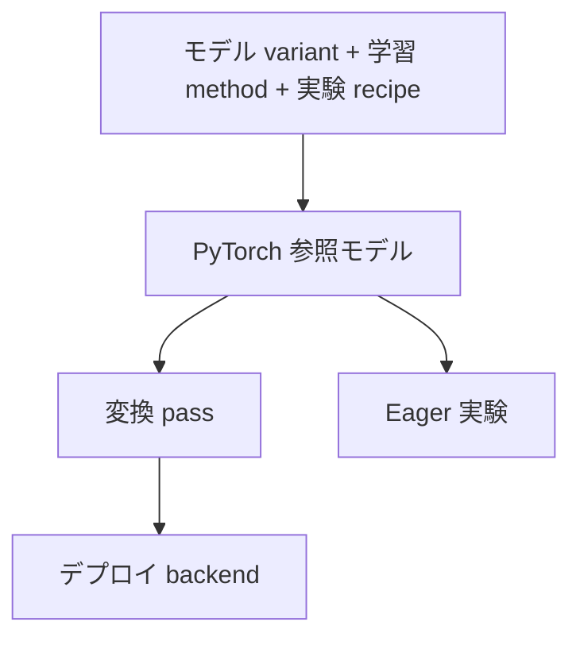

# アーキテクチャ設計提案

[English](../design-proposal.md) | 日本語

RT-DETR の意味論を保ちながら、研究拡張とデプロイ向け最適化を組み込むための設計提案である。
新しい部品をどこに配置し、何を検証するかを判断する PyTorch 開発者を対象とする。

**位置付け:** 設計提案 v0.3（2026-09-05）に基づくアーキテクチャの目標である。
以下のインターフェース、デプロイ構成、受け入れ基準は提案である。
実装済み API と測定結果は[拡張ガイド](extensions.md)と[ロードマップ](roadmap.md)を参照する。

## 互換性の基準

初期の基準は `rtdetr_pytorch` の RT-DETR-R50vd である。
COCO 80 クラス、640×640 RGB 入力、300 query、decoder 6 層を使う。
上流のリビジョンは `068dfde65f2667ad6555883c69d73de886518cad` である。
設定と重みの出典は[ベースラインのメタデータ](../../benchmarks/baseline.json)と
[上流コードの記録](../../third_party/RT-DETR/README.md)で固定する。

最適化を加える前に、基準実装の計算を維持する。アーキテクチャ、目的関数、数値的な挙動を
変える場合は、その変更の設定と比較結果を記録する。
汎用の物体検出フレームワークや、すべての backbone・手法・backend の組み合わせへの対応は目標にしない。

## 計算・変換・実行を分ける

矢印は構築と実行の流れである。コードの依存方向は、backend → 変換・export → モデル・共有契約とする。
参照モデルは backend SDK や学習フレームワークに依存させない。
PyTorch module とテンソルの export schema から始め、独自の中間表現は作らない。

| 参照実装の部品 | 責務 |
| --- | --- |
| Backbone と HybridEncoder | 多段階の特徴を生成し、要求された場合は AIFI 境界の特徴を明示的に返す |
| MemoryProjector | decoder 用に特徴を投影・flatten し、実際の特徴から各 level の形状と offset を導く |
| QuerySelector | anchor 生成、memory の採点、top-k query 選択、勾配を持つ encoder 補助予測の保持 |
| Query の組み立て | 準備済み DN と matching query、mask、初期 reference を結合する |
| Decoder と予測 head | attention と反復更新を実行し、各層の head と勾配経路を所有する |
| 学習 wrapper | DN embedding と補助 module を登録し、query の生成・予測の分離・損失への割り当ての受け渡しを行う |
| Postprocessor | 生の予測を score、クラスインデックス、元画像座標に変換する |

この表は責務の境界を示すもので、各行に公開 class を設ける要件ではない。
box head は次の decoder 層の reference を更新するため、計算を変えずに decoder 後段へ一括移動できない。

## テンソルと勾配の契約を保つ

契約には形状、dtype、layout、座標系、mask、勾配の所有者を定義する。
現在の型は[拡張ガイド](extensions.md)を参照する。
将来の variant は独自の更新状態と学習 payload を定義できる。
共通の最終検出境界には logits `[B, Q, K]` と正規化 cxcywh box `[B, Q, 4]` を返す。
`B` はバッチサイズ、`Q` は query 数、`K` はクラス数である。

基準実装の次の挙動は、一致検証の対象にする。

- 各 level を `feature.flatten(2).transpose(1, 2)` で変換し、順に連結する。
  空間形状は実際の特徴から導く。
- box の `(cx, cy, w, h)` と元画像サイズの `(W, H)` を区別する。
  基準の前処理は画像全体を 640×640 に resize し、padding や mean/std 正規化は行わない。
  後処理で box を暗黙に clip しない。
- anchor mask の `True` は有効、attention mask の `True` は遮断を意味する。
  無効 anchor の意図した `+inf` logits を維持する。
- `enc_logits.max(-1)` による top-k を維持する。
  無効な memory のゼロ化と、score の `-inf` masking は異なる計算である。
- 特徴で初期化した query content と初期 reference logits は detach し、encoder 補助予測の勾配は保持する。
  層間 reference の detach と、補助 box 予測用 reference の勾配経路を個別に検証する。
- self-attention と多段階の deformable cross-attention は別の交換点にし、
  mask・sampling 座標・勾配を検証する。
- 推論の top-k は `Q×K` 全体の sigmoid score から選ぶ。
  同じ box が複数ラベルで残ることがあり、query ごとのクラス選択や NMS を加えると挙動が変わる。

DN と matching の slot を識別できるようにする。
core は準備済み query を受け取り、データセットの target やノイズ生成の状態を持たない。
DN 生成、metadata、損失の割り当ては training が所有し、全 target が空の場合の経路も定義する。

## 研究拡張を組み立てる

アプリケーション境界で明示的な constructor または factory を使う。
提案する構成は、次の 3 つに責務を分ける。

| 所有者 | 決定する内容 |
| --- | --- |
| `ModelVariant` | 推論の計算・パラメータ・更新状態・予測の契約 |
| `TrainingMethod` | DN、補助分岐、teacher、損失、共有重み、状態を持つ学習制御 |
| `ExperimentRecipe` | variant/method、データ変換、optimizer group、schedule、シード、再現対象 |

これらの名前は設計上の役割であり、利用可能な constructor ではない。
Hydra はアプリケーションを組み立て、モデルには構築済みの依存先を渡す。
channels・strides・level 数は、可能な限り特徴の仕様から導く。
互換性のない payload や状態の所有権の競合は、構成時に拒否する。

[checkout の recipe](../../recipes/README.md)で、次の境界を検証する。

| 拡張 | 検証する境界 |
| --- | --- |
| DEIM | データの構成と MAL 分類損失。matcher の交換だけでは Dense O2O の augmentation を表現できない |
| D-FINE | 分布による更新状態・head・box decode と、対応する損失・自己蒸留 |
| RT-DETRv3 | CNN 補助予測、個別の query group と mask、共有 decoder の呼び出し、group ごとの割り当て |
| RT-DETRv4 | AIFI 後・CCFF 前の特徴、凍結 teacher、学習可能な投影、蒸留損失、勾配に基づく重み制御 |
| DEIM + D-FINE | 分布回帰の variant と、対応する分類損失・データ recipe の組み合わせ |

回帰表現の変更はアーキテクチャの変更である。
別の student に蒸留手法を適用する実験と、公式モデルを再現する実験を区別する。
式、出典、検証状況は各 recipe が所有する。詳細は[recipe の責務分担](recipe-boundaries.md)を参照する。

## 学習状態の所有者を明示する

共有 decoder の重み、DN embedding、学習可能な criterion のパラメータも含め、
各パラメータを一度だけ登録する。teacher は凍結して評価モードにし、student と projector の勾配は保持する。
teacher の前処理と特徴の対応付けには、比較する画像領域へ適用した augmentation も明記する。

勾配に基づく controller では、観測時点、AMP の unscale、accumulation の単位、
rank 間の集約、clipping との順序、更新間隔を定義する。
既定案では、unscale 後、clipping と optimizer step の前に観測する。
係数と蓄積した統計はチェックポイントに保存する。

初期の再開対象はエポック境界である。モデル・wrapper、optimizer、scheduler、EMA、AMP scaler、
epoch/step、RNG、sampler の状態を、宣言した実行仕様に応じて記録する。
任意のバッチ位置からの再開は別要件である。現在の限定された検証範囲は
[Lightning ガイド](lightning.md)を参照する。

デプロイ時には学習後の student の推論経路を抽出し、不要な学習分岐、teacher、projector、損失、controller を外す。
同じ重みと decoder 実行計画を使い、抽出前の student の評価経路と比較する。
推論に必要な分布更新などの計算は残す。

## 変換の実行仕様を検証する

各 pass は、入力 variant、前提条件、変換内容、検証区分を宣言する。
参照モデルは変更せず、別のデプロイ用 module を生成する。

| 検証区分 | 例 | 必要な比較 |
| --- | --- | --- |
| 数値等価 | Conv/BN fusion、RepVGG の再パラメータ化、固定形状の定数化 | 宣言した許容誤差内での段階別出力の一致 |
| 実行計画に対する等価 | decoder 層数の選択、最終出力のみの export | 同じ計画の参照実装との比較。全層 baseline からの精度変化は別途記録 |
| 近似 | 低精度化、量子化、近似 kernel | 事前に定めた許容範囲に対する数値誤差と AP 低下 |

実行計画を固定してから、FP32 fusion、形状の特殊化、backend 向け変換・精度設定、export の順に進める。
pass の順序と矛盾する組み合わせを検証し、固定形状の anchor を宣言外の形状へ流用しない。
個々の pass に加え、すべての変換を適用したモデル全体も比較する。

各成果物の manifest には、ソースのリビジョン、設定・重みのハッシュ、schema version、
順序付きの pass 名・version・引数、形状、精度、device、toolchain、検証結果を記録する。
INT8 を追加する場合は calibration data と前処理の識別子も必要である。

## エクスポート境界を定義する

最初はモデル全体の `(images) → (logits, boxes)` を export する。
後処理を統合する場合は `original_sizes_wh` と検出出力を含む別 schema を使う。
Python の契約をテンソルへ変換する際に、出力名・順序・schema version を固定する。

次の分割案は decoder memory の境界である。
前段の backbone/encoder/projector と後段の query selection/decoder を接続して検証し、
実行時間に加えて転送・同期・layout 変換も測定する。分割による高速化は前提にしない。

`variant × inference plan × backend profile` ごとに検証する。
runtime version、opset、device、精度、形状、plugin、未対応演算を記録する。
dynamic batch と可変 H/W は個別に検証し、memory 長は特徴の形状から導く。
未対応演算は明示的に失敗させ、許可する CPU fallback がある場合は報告する。

## 受け入れ基準と再現性

重みの対応付け、段階別出力、損失・勾配、データセット指標、backend 実行の順に検証する。
ソースのリビジョン、解決済み設定、重みのハッシュと `model`/`ema` の選択、入力、前処理、evaluator を固定する。
top-k の同点では score と選択 index を保存し、最初に差が生じた段階を報告する。
不一致を隠すために結果を並べ替えない。

元の提案の**未測定の初期目標**は、同一評価条件での変換済み重みの AP 差を 0.1 point 以内、
同じ実行計画・環境での上流 eager に対する速度低下を中央値で 3% 以内とするものである。
現在のリリース基準や実測値ではない。段階別の許容誤差と実行仕様ごとの AP・レイテンシ許容範囲は
検証前に定め、変更を記録する。再学習の許容幅はシード間のばらつきから決め、重み変換の目標値を流用しない。

学習済み重みの評価、独立した再学習、ablation は別の実験として報告する。
シード、ソース変更、teacher の出典、データ、query group、損失、controller の状態、学習コスト、推論条件を含める。
モデル単体と前後処理込みのレイテンシを分け、warm-up・同期・測定回数・p50/p95・throughput・最大メモリを記録する。

各拡張の受け入れ段階は独立している。

| 段階 | 必要な根拠 |
| --- | --- |
| `contract-tested` | forward/backward と統合検証、パラメータ所有権、不正構成の拒否、baseline の非回帰、推論経路の抽出 |
| `reproduced` | 固定した公式 recipe、学習・再開の検証、データセット指標 |
| `export-verified` | 宣言した schema・形状での出力一致 |
| `backend-verified` | 特定の runtime 構成での数値・精度・性能結果 |

研究コードは `contract-tested` の段階で受け入れる。
デプロイの順序案は、固定形状 ONNX Runtime、memory 境界の分割と変換 pass、TensorRT FP16 である。
手法全体の再現は独立して進める。現在の達成状況と残る測定は[ロードマップ](roadmap.md)に記録する。
